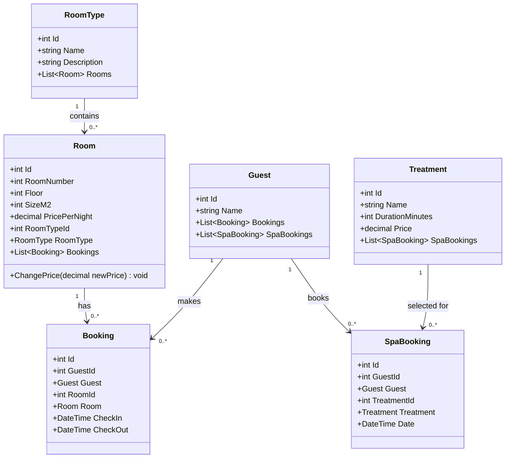

# HotelGrandioso — kodmappen

The program itself is located here, Hotel Grandioso. Each folder has its own README which describes what should be placed there.

| Mapp | Innehåll |
|------|----------|
| `Models/` | Classes that represent what you are handling (entities) |
| `Data/` | Database connection and context (EF Core) |
| `Services/` | Logic that connects models and data, for example, Repository |
| `UI/` | The interface: console, Blazor, or MVC |

`Program.cs` is the starting point. It should be brief and simply connect the parts.

## Tips

- Place each class in its own file, with the same name as the class.
- Keep names in Swedish in printouts and the UI, and in English in the code (classes, methods, variables).
- Comments in English, and explain the "why" rather than the "what."

## UML Class Diagram

The following UML class diagram represents the six entity classes used in Hotel Grandioso.

It shows the properties, navigation properties, and relationships between the entities.

### Entity Relationships

- **RoomType and Room:** One room type can contain multiple rooms. Each room belongs to one room type.
- **Room and Booking:** One room can have multiple bookings over different date ranges. Each booking refers to one room.
- **Guest and Booking:** One guest can make multiple room reservations. Each booking belongs to one guest.
- **Guest and SpaBooking:** One guest can make multiple spa reservations.
- **Treatment and SpaBooking:** One spa treatment can be associated with multiple spa reservations.

Relationships are implemented using foreign keys and EF Core navigation properties.

## GDPR Considerations

Hotel Grandioso follows the GDPR principle of data minimisation by storing only the personal information necessary for the booking system.

### Guest Entity

The `Guest` class contains:

| Field | Purpose |
|-------|---------|
| `Id` | Uniquely identifies a guest and connects their room and spa reservations. |
| `Name` | Identifies the guest associated with a reservation. |

The `Guest` entity also has navigation properties for room and spa bookings. These represent relationships rather than additional personal information fields.

### Data Minimisation

Unnecessary personal information, such as hair colour, height, and religion, is not collected.

Religion is also considered a special category of personal data under GDPR and requires additional protection.

### Design Decisions

- Only essential guest information is stored.
- Guest data is linked to reservations using foreign keys.
- Personal information is not unnecessarily duplicated across booking records.
- EF Core manages the relationships between guests and their reservations.

This design demonstrates data minimisation. A production system would also require appropriate access controls, retention policies, and procedures for handling personal data requests.

