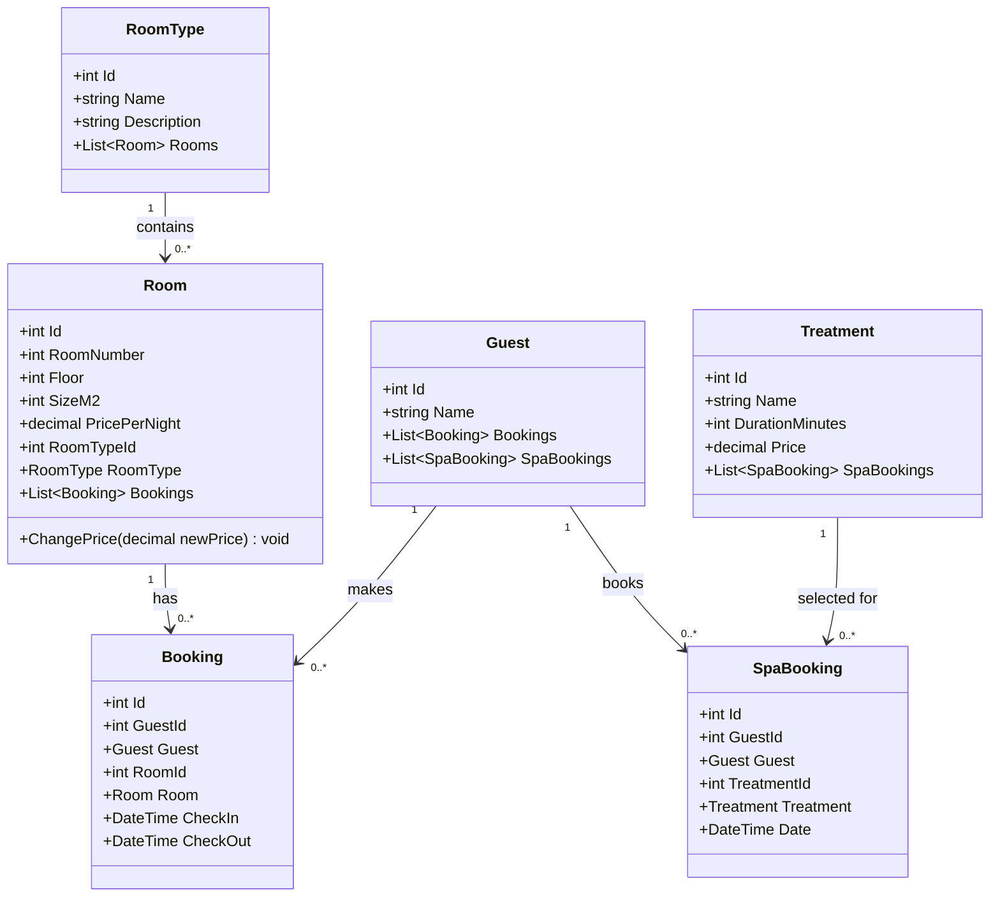

# HotelGrandioso 

## Project Overview

Hotel Grandioso is a console-based hotel booking system developed in C# using object-oriented programming and Entity Framework Core with SQLite.

The application manages hotel rooms, guest reservations, and spa treatments. It demonstrates class relationships, interfaces, the Repository Pattern, LINQ, and database persistence.


## Implemented Features

### G — Approved

- Book hotel rooms for guests using check-in and check-out dates.
- Cancel existing room reservations.
- Calculate booking prices based on the number of nights.
- Display all current room bookings.
- Show all rooms with their types and nightly prices.
- Use EF Core Code First with database migrations.
- Organize the application into models, services, data, and UI layers.
- Document entity relationships using a UML class diagram.
- Evaluate guest data according to GDPR principles.

### VG — Well Approved

- Prevent overlapping reservations for the same room.
- Book spa treatments for guests at a selected date and time.
- Display available rooms for a specified date range.
- Use LINQ to check room availability and booking conflicts.
- Coordinate booking creation using a database transaction.


## Application Architecture

| Folder / File | Responsibility |
|---------------|----------------|
| `Models/` | Entity classes and relationships |
| `Data/` | EF Core database context and initial data |
| `Migrations/` | Database schema migrations |
| `Services/` | Repository implementation and business logic |
| `UI/` | Console-based user interface |
| `Program.cs` | Database initialization and application startup |

### Repository Pattern

The application uses `IHotelRepository` and `HotelRepository` to separate database access from business logic.

`IHotelRepository` defines the database operations, while `HotelRepository` implements them using Entity Framework Core.

`BookingService` and `SpaService` depend on the repository interface rather than accessing the database directly.

This design reduces coupling, supports the Single Responsibility Principle, and makes the application easier to test and maintain.


## Installation and Setup

### Requirements

- .NET 10 SDK
- Visual Studio with .NET development support
- Entity Framework Core packages
- SQLite

### Database Configuration

Set the `HOTEL_DB` environment variable to a SQLite connection string.

Example for Windows:

`HOTEL_DB=Data Source=C:\path\to\hotel.db`

The connection string is read from the environment variable and is not hardcoded in the source code.

The database file is excluded from Git using `.gitignore`.

### Run the Application

1. Clone the repository.
2. Open `HotelGrandioso.slnx` in Visual Studio.
3. Restore NuGet packages if necessary.
4. Configure the `HOTEL_DB` environment variable.
5. Build and run the application.

On startup, the application applies pending EF Core migrations and inserts the initial hotel data if necessary.

### Console Menu

The application provides the following options:

1. Show all rooms.
2. Show available rooms.
3. Book a room.
4. Cancel a booking.
5. Show all bookings.
6. Show spa treatments.
7. Book a spa treatment.
0. Exit.


## Booking Availability Using LINQ

To detect overlapping reservations, the repository checks:

```csharp id="1tzbtu"
b.RoomId == booking.RoomId &&
b.CheckIn < booking.CheckOut &&
booking.CheckIn < b.CheckOut
```

The conditions determine whether an existing booking belongs to the same room and overlaps the requested date range.

The repository uses `Any()` to determine whether a conflict exists and `Where()` to retrieve rooms without overlapping bookings.

The checkout date is exclusive, so a new guest can check in on the same date the previous guest checks out.

The booking conflict check and database insertion are performed inside a transaction to coordinate concurrent operations.


## UML Class Diagram

The following UML class diagram represents the six entity classes used in Hotel Grandioso.

It shows the properties, navigation properties, and relationships between the entities.



### Entity Relationships

- **RoomType and Room:** One room type can contain multiple rooms. Each room belongs to one room type.
- **Room and Booking:** One room can have multiple bookings over different date ranges. Each booking refers to one room.
- **Guest and Booking:** One guest can make multiple room reservations. Each booking belongs to one guest.
- **Guest and SpaBooking:** One guest can make multiple spa reservations.
- **Treatment and SpaBooking:** One spa treatment can be associated with multiple spa reservations.

Relationships are implemented using foreign keys and EF Core navigation properties.


## GDPR Considerations

Hotel Grandioso follows the GDPR principle of data minimisation by storing only the personal information necessary for the booking system.

### Guest Entity

The `Guest` class contains:

| Field | Purpose |
|-------|---------|
| `Id` | Uniquely identifies a guest and connects their room and spa reservations. |
| `Name` | Identifies the guest associated with a reservation. |

The `Guest` entity also has navigation properties for room and spa bookings. These represent relationships rather than additional personal information fields.

### Data Minimisation

Unnecessary personal information, such as hair colour, height, and religion, is not collected.

Religion is also considered a special category of personal data under GDPR and requires additional protection.

### Design Decisions

- Only essential guest information is stored.
- Guest data is linked to reservations using foreign keys.
- Personal information is not unnecessarily duplicated across booking records.
- EF Core manages the relationships between guests and their reservations.

This design demonstrates data minimisation. A production system would also require appropriate access controls, retention policies, and procedures for handling personal data requests.

